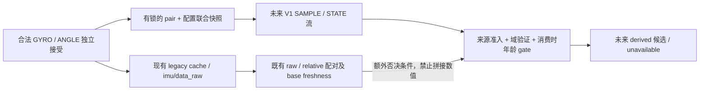

# IMU 组件年龄与时序来源契约 — v0.5.0-020A.7

## 1. 状态、范围与权威关系

本文冻结 **future contract 的结构与判定语义**，不表示接口已经实现或硬件已经可用。
文档审查基线为 `develop@c86be2c2f9f08f78a2a3ab5d7917a012fec158c3`。
所有具体年龄阈值 **NOT FROZEN**；跨节点契约实现及部署验证 **NOT IMPLEMENTED / NOT VERIFIED**。
`relative_roll_rate_rad_s` 仍 **PLANNED / NOT IMPLEMENTED**，020B、ALG-007 Candidate 仍 **BLOCKED**。
本轮不创建消息、服务、publisher、subscriber、参数、测试或任何硬件执行路径。

仓库安全与执行授权遵守 [AGENTS.md](../AGENTS.md)，软件协作遵守
[开发流程](DEVELOPMENT_WORKFLOW.md)。[ALG-007 §7.3](algorithm_tasks/ALG-007.md#73-public-compatibility-and-fail-close-semantics--frozen-design)
及 §7.9 的 base/derived 分离、Level-2、校准保护和配置检查前置条件继续有效。
本契约补足 host temporal provenance；不把历史设计中的未实现状态改写为当时已经实现。

## 2. 当前实现审查：时间在哪里丢失

| 层与依据 | 基线已有行为 | 尚不能推出的性质 |
| --- | --- | --- |
| [imu_protocol.py](../src/imu_cybergear_ros2/imu_cybergear_ros2/imu_protocol.py) | `ImuFrameComponent` 保存合法完整帧的 `received_monotonic: float`、generation、type、values；GYRO 为 rad/s，ANGLE 为度；pair 保存两组件和 sequence | 没有有限年龄保证；时间不是模块采样时间 |
| [imu_driver_node.py](../src/imu_cybergear_ros2/imu_cybergear_ros2/imu_driver_node.py) | reader 分批 read 后逐字节解析；ANGLE 触发 legacy cache 发布；ROS clock 生成 `header.stamp`；coherence/configuration 有进程内只读快照 | `/imu/data_raw` 不携带组件独立时间、严格 pair 身份或配置代次；独立读取两个快照不等于原子联合快照 |
| [relative observer](../src/imu_cybergear_ros2/imu_cybergear_ros2/imu_relative_observer_node.py) | 从 ROS quaternion 产生相对姿态并复制 header；激活发布零点代次 | 零点代次不等于 parser/config generation；header 配对不证明严格 GYRO→ANGLE |
| [Flight imu_adapter.py](../src/windarmor_flight_control/windarmor_flight_control/runtime/imu_adapter.py) 与 [observations.py](../src/windarmor_flight_control/windarmor_flight_control/runtime/observations.py) | 按相同 ROS source stamp 配 raw/relative；各自记录 callback `received_at`；拒绝已配对 stamp 的重复/倒序 | 无法从合成值或 stamp 恢复已丢失的组件时间与身份 |
| [aggregator](../src/windarmor_flight_control/windarmor_flight_control/runtime/state_aggregator.py) 与 [Runtime node](../src/windarmor_flight_control/windarmor_flight_control/runtime/node.py) | RLock 内组装不可变 snapshot；Runtime 使用可注入 monotonic；tick 先取 now，稍后调用 controller update | tick 开头时间不等于实际消费时刻；锁不提供跨进程时钟域证明 |
| [models.py](../src/windarmor_flight_control/windarmor_flight_control/core/models.py) 与 [validation.py](../src/windarmor_flight_control/windarmor_flight_control/core/validation.py) | 已有 base 字段和完整性/finite/valid/fresh 检查；无 roll-rate 字段 | 不能把未来接口或 gate 写成已存在的 API |

当前 `sample_age_sec = max(0, snapshot_now - min(raw.received_at, relative.received_at))`。
它是 Flight 本地已配对观测的回调接收年龄：不覆盖首次回调前 DDS 排队、driver 中等待、
USB/内核缓冲和设备内采样/滤波年龄。[Flight YAML](../src/windarmor_flight_control/config/flight_control.yaml)
的 `flight_imu_freshness_sec=0.2` 仅用于该 base freshness。现有 clamp 是当前行为，
不得用它实现本文的未来时钟异常处理。

现有测试分别覆盖 [parser 时间/顺序/重置](../src/imu_cybergear_ros2/test/test_imu_protocol.py)、
[fake serial 生命周期](../src/imu_cybergear_ros2/test/test_imu_driver_coherence.py)、
[配置后新 pair](../src/imu_cybergear_ros2/test/test_imu_config_runtime.py)、
[ROS stamp 与本地年龄](../src/windarmor_flight_control/test/test_imu_adapter.py)、
[snapshot 时钟](../src/windarmor_flight_control/test/test_state_aggregator.py)。
parser 的现有 fake clock 测试允许 GYRO 在 10 秒、ANGLE 在 70 秒形成历史 pair；
它明确证明 Level-2 FSM 未施加 finite gap，而不是验证 60 秒可供控制使用。

## 3. 时间定义、公式与证据层级

未来 V1 时间值为同一已验证域内的非负整数纳秒。组件顺序由合法事件及身份决定，
不要求时间读数严格递增：时钟分辨率可能使先后事件读数相同。

| 符号 | 定义与记录位置 |
| --- | --- |
| `t_gyro`、`t_angle` | parser 在对应完整帧通过校验及解码、接受不可变组件时各读取一次源 monotonic；不是 read 开始/结束或字节在线到达时间 |
| `t_pair` | **逻辑形成时间定义为 `t_angle`**；只在本次 ANGLE 确实消费同代次新 pending GYRO 时有值；不把其后的对象构造或日志时间冒充精确形成时刻 |
| `t_publish` | producer 将已完成的不可变记录提交给 ROS publisher 前的源 monotonic 读数；不证明 DDS 实际发包时刻 |
| `ros_header_stamp` | 既有 ROS clock 的关联/显示时间；可能受 sim time 或跳变影响，不参与 monotonic 年龄相减 |
| `t_callback` | Flight 接到本条 typed 记录、处理前记录的本地 monotonic 时间；保留源时间不重写 |
| `t_consume` | 未来 derived consumer 进入 controller update 前，完成原子快照选择和 gate 时的新 monotonic 读数；不能复用较早 tick/callback 时间 |
| 厂家采样时间 | 当前未知；TIME 帧未证明组件的物理同采样绑定；不能填入以上字段 |

```text
gyro_age_at_consume  = t_consume - t_gyro
angle_age_at_consume = t_consume - t_angle
pair_gap            = t_angle - t_gyro
oldest_component_age = max(gyro_age_at_consume, angle_age_at_consume)
pair_age_at_consume  = t_consume - t_pair
source_queue_age    = t_publish - t_pair
transport_queue_age = t_callback - t_publish
flight_local_age    = t_consume - t_callback
```

上述差值只在身份、代次与时钟域先通过后才有意义。完整因果顺序为
`checked <= t_gyro <= t_angle = t_pair <= t_publish <= t_callback <= t_consume`，
并要求对应配置、组件的事件顺序确实是检查后重新接受，不以相同 timestamp 代替事件顺序证明。
负值、倒退、非法表示、溢出或跨域均拒绝，**不 clamp、不取绝对值、不重新打接收时间掩盖**。

V1 不额外存储可独立漂移的 `t_pair` 字段；从 `angle_received_ns` 唯一导出。
如果未来需要独立的实际构造/发布测量，另加明确命名的诊断时间，不能改变本定义。
对有序 pair，`oldest_component_age = pair_gap + pair_age_at_consume`；
且 `pair_age_at_consume = source_queue_age + transport_queue_age + flight_local_age`。
不同名称反映不同责任，并不意味着数学独立。

所有这些都是 **host receive provenance**。内核积压的旧帧可在一次 read 后快速解析，
即使 gap 很小也不能证明物理年龄很小。若控制误差预算要求物理采样年龄，另需可证明的设备/
传输缓冲时延或厂家采样标识；host-age gate 不能替代该证据。

## 4. 跨进程时钟域：选择及验证

### 4.1 机制选择

| 方案 | 结论 |
| --- | --- |
| 同主机、同 boot、同 time namespace、同 `CLOCK_MONOTONIC`，传源接收 ns | **V1 选择**；须通过下述本地验证，不能仅假设都叫 monotonic |
| 版本化消息携带时钟域、session 和代次 | **与上一项一起必需**；字段相同本身不是部署证明 |
| 仅传 source-side age | 不选择：消费时尚须加源计算后排队/通信/本地等待；没有延迟界限就低估年龄；若传计算时刻及同域证明则退化为源时间方案 |
| 不同/无法验证的域 | `CLOCK_DOMAIN_UNVERIFIED`，future derived unavailable；不自动校时或从 header 猜偏移 |

Python 的 `time.monotonic()` 返回浮点秒；`time.monotonic_ns()` 是相同单调时钟语义的整数
纳秒接口，可避免 float 表示损失。不同调用时间本就不同，不能要求两次返回值精确按 `1e9`
相等。[Python 3.12 time 文档](https://docs.python.org/3.12/library/time.html#time.monotonic_ns)

Linux time namespace 可以改变 monotonic 的偏移，同一物理主机仍不必处于同一时间坐标。
[Linux time_namespaces(7)](https://man7.org/linux/man-pages/man7/time_namespaces.7.html)
因此 `frame_id`、hostname、ROS_DOMAIN_ID、相同 boot 字符串或“在同一容器宿主机”都不足以
单独通过验证。

### 4.2 V1 本地域准入

未来本地准入层必须在源与 Flight 启动/重新准入时核实：

1. 两个 endpoint 由同一个受信任的本地部署管理者绑定到实际存活的同 kernel host，
   记录 host instance 与 boot 身份；不接受仅由远端消息声明的 host 身份。
2. 比较实际进程的 time namespace 对象身份（Linux nsfs device/inode，并由 host/boot 限定）；
   使用稳定进程身份绑定，防止 PID 重用。管理者不能观察时则拒绝；不把 namespace inode 当作
   跨主机全局身份。容器有不同 namespace、隐藏/伪装标识或身份不可读时不作 offset 猜测。
3. 核对双方 `time.get_clock_info('monotonic')`：单调、相同且已审查的
   `clock_gettime(CLOCK_MONOTONIC)` backend；不用 `CLOCK_MONOTONIC_RAW`、ROS clock 或
   `perf_counter` 的同名/同量纲替代。双方时钟注入必须保留同一可验证域。
4. 本地管理者为该不可变 tuple 分配 `clock_domain_id`；源记录携带完整域描述，Flight 与
   **本地独立核实的 tuple** 逐项比较。域描述不是任意 YAML 字符串的自我证明，也不声称防御
   恶意伪造 publisher；本契约的故障模型是受信任进程中的重启、排队和配置错误。
5. clock domain/boot/进程绑定变化即撤销准入；新证据前不可用。实现与 Pi 部署上的这套验证
   **尚未执行**；如果未来无法实现验证，V1 gate 必须保持关闭，不能降低准入条件。

本地绑定选择由同一个 supervisor 启动/登记两个进程，经仅限本地的继承控制通道绑定稳定
进程句柄、source session 和 DDS writer 身份；接收侧核对实际 writer 身份，不只读 payload
里的 source_id。进程退出或 writer 更换即撤销。部署没有该 supervisor、不能稳定绑定进程
或不能核对 writer 时均不准入；具体 ROS/local-IPC 实现仍需后续 review 与软件/部署验证。

Linux `CLOCK_MONOTONIC` 不计系统 suspend；V1 要求 capability 有效期间不发生 suspend，
恢复后撤销旧准入、清空 derived 状态并重新取得新 pair。不能把暂停期间的真实时间当作零。
检测/禁止暂停的部署机制仍待实现验证，不修改本轮系统配置。
[Linux clock_gettime(2)](https://man7.org/linux/man-pages/man2/clock_gettime.2.html)

ROS clock、系统墙钟、`header.stamp` 和 `/clock` sim time 均与上述域不同。ROS 时间跳变
不重写源 ns；若导致现有 base 不可用，future derived 仍受 base gate 否决。
bag playback 不自动成为 LIVE 来源；离线 replay 使用显式 fake domain/clock，结果不能进入
生产 availability。未来跨主机须另行冻结时钟映射、偏移/漂移误差上界、同步失效检测和
延迟预算，并按最坏误差扩展年龄后判定；V1 不包含该能力。

## 5. 原子数据接口与来源准入

### 5.1 选择方案 A

保留现有 `/imu/data_raw`、relative topic 及接口原义；未来新增 typed
`windarmor_interfaces/msg/ImuTemporalObservationV1`，建议固定 topic 为
`/imu/temporal_observation_v1`。**以上名称是未来设计，不是当前可调用接口。**
严格 consumer 只能使用本条消息中的 GYRO 与 ANGLE 值及 provenance，不能拿 legacy cache 的
值与另一条 metadata 拼接。选择 A 是因为单条记录可以直接约束值与身份的原子一致性。



方案 B（独立数据与 metadata 话题）不选为冻结契约：当前 ROS stamp 既不包含 source session，
也不标识严格 pair；重启、重复 stamp、丢包与异步发布可破坏关联。仅比较数值/近似时间或
“最近 metadata”均禁止。未来若再评审 B，必须另有完整不可歧义 key、无界等待的替代及
丢失/重排拒绝证明，不能借本文自动授权。

V1 的逻辑记录为 `SAMPLE | STATE` tagged union，在**同一个来源流**串行发布。
`STATE` 传递失效/观察状态，不含可用组件载荷；`SAMPLE` 携带完整两组件。
IDL 的具体编码留给实现 review，但必须保持下表的类型、关联与缺失语义，不用零时间/
全零向量充当 unknown。新 schema 不被旧 consumer 静默接受。

### 5.2 字段契约

| 逻辑字段 | V1 类型与不变量 |
| --- | --- |
| `schema_version`、`record_kind`、`mode` | uint32 版本 `1`；枚举 `SAMPLE/STATE`；枚举 `LIVE/REPLAY`；生产只准入 LIVE。mode 不能替代来源验证 |
| `source_id` | 部署选定的唯一逻辑 IMU 来源；相同 topic 的其他来源不自动接管 |
| `source_session_id` | 每次 source process 启动全新 UUID128；不由 PID、墙钟、generation 或 pair sequence 代替；重用属于协议错误 |
| `clock_domain_id`、`host_instance_id`、`boot_id`、`time_namespace_id`、`clock_kind` | §4 的独立验证描述；clock kind 固定 `CLOCK_MONOTONIC`；缺失/不匹配不得比较时间 |
| `transport_generation` | 同一 session 内每次新连接尝试前递增，失败连接不恢复旧值；与 parser reset 不是同义计数 |
| `parser_generation` | parser 对当前合法字节的代次；映射现有 generation 语义；两组件必须相同 |
| `configuration_generation`、`configuration_status` | 每次验证上下文失效/开始新一轮均换代，不能把先前成功复制到新代；status 保留现有条件性类别及含义 |
| `required_values_passed`、`observation_complete`、`checked_ns` | 当前配置代次结果及检查提交时间；两布尔量不等价。未检查时 checked 缺失，不能填零成功 |
| `configuration_assumptions` | 保留有限应答寿命 B、sole requester、stable config 的声明及其证据状态；`host-associated-checked` 不升级为厂家关联 |
| `pair_generation` | session 内单调的**严格 pair 有效上下文 epoch**；parser/transport/lifecycle/config 失效均递增；即使 parser 数字没变也必须隔离；不与 zero-generation 混用 |
| `pair_sequence` | 当前 parser generation 的历史配对计数，对应现有 `GyroAnglePair.sequence`；只有 SAMPLE 存在；递增不等于连续无丢包 |
| `publication_sequence` | session 内 SAMPLE/STATE 共用的严格递增 uint64 记录序号；服务快照不占号；用于状态与样本统一排序 |
| `source_event_sequence`、组件 `accepted_event_sequence`、`checked_event_sequence` | session 内源串行事件计数：接受合法组件、配置提交、失效和准入 barrier 各占新号；组件/checked 保存其事件号，消息保存快照事件号；用于相同 ns 时仍验证先后 |
| `gyro_component` | type=`0x52`，三个有限 body-frame rad/s 值、`parser_generation`、`received_ns=t_gyro`；保持现有坐标及解码契约 |
| `angle_component` | type=`0x53`，三个有限 Euler 度值、相同 parser generation、`received_ns=t_angle`；不得用软件 quaternion 的生成时间替代 |
| `coherence_level`、`post_check_pair` | SAMPLE 仅声明 Level 整数 `2`；post_check_pair 为 bool，表示是否在本配置 epoch 检查后重新接受两组件，依事件顺序与时间联合核对；不声称 Level-3/4 |
| `publish_ns`、`observation_status`、`unavailable_reasons` | `publish_ns=t_publish`；`PAIR_OBSERVED/UNAVAILABLE` 为诊断；reason 使用 §6 的确定顺序集合；PAIR_OBSERVED 不是 ALG-007 READY |

时间字段为 uint64 ns；计数器均为 uint64 且不得 wrap，耗尽时停止来源并建立新 session，不比较环绕大小。
未来 source 必须在原接受点以 `monotonic_ns()` 取时，float 兼容视图可由它派生；
不能把现有 float 乘 `1e9` 就声称恢复了未记录的整数精度。020A.6 float 时间保持历史原义。

严格身份为：

```text
pair_key = (source_id, source_session_id, clock_domain_id,
            transport_generation, parser_generation,
            configuration_generation, pair_generation, pair_sequence)
record_key = (source_id, source_session_id, publication_sequence)
```

组件 values、组件时间、这些 key、配置结果必须从一次有锁的联合快照取得，并作为一条
不可变记录提交。失效与 SAMPLE/STATE 的赋号/提交必须串行化；旧 epoch 的样本不得在新
失效记录之后重新提交为新记录。若只能分开读 `coherence_state()` 与 `configuration_state()`，
必须改为原子联合 snapshot，不能凭两次读到相同数字猜测中间没有 reset。
可用候选还须满足 `checked_event_sequence < gyro.accepted_event_sequence <
angle.accepted_event_sequence <= source_event_sequence`；准入 barrier 的事件号另作下界。

`SAMPLE` 可保存配置尚未通过时的合法 Level-2 诊断 pair，但状态必须为 UNAVAILABLE，
checked 缺失或 post_check=false 不得通过 gate。STATE 中没有 pair；独立历史缓存不能自动
补入 STATE，unknown 与全零合法测量必须可区分。

### 5.3 新 consumer 与 publisher 的实时准入

未来需要配套只读 typed 准入快照服务，设计名 `/imu/temporal_admission_v1`；
它仅复制现有进程状态，**不得打开串口、发 READADDR、激活节点或改变配置**。
本轮不创建该服务。其请求含全新 consumer session UUID 与随机 challenge；响应回显 challenge，
给出当前完整来源/域/epoch tuple、配置状态、当前 publication watermark、同域 `barrier_ns`
及新分配的 `barrier_event_sequence`。
响应与流提交在相同串行化边界取快照，记录在响应后的新合法组件才能恢复 consumer。

Flight 首次启动、来源/epoch 更换或准入失效后须：

1. 通过本地管理者独立绑定 service 与流的同一个存活 publisher/session，验证 §4；多个活动
   producer、身份不明或 replay 均拒绝，不能“最后一个消息来源胜出”。
2. 只接受本次未使用 challenge 的响应，且 Flight callback/consume 与 barrier 的因果关系成立。
   服务超时/响应不完整保持 unavailable；不得反复使用旧响应恢复。
3. 只接纳同 tuple、`publication_sequence > watermark`、GYRO 与 ANGLE 均在 barrier 后
   **重新接受**的 SAMPLE；同时满足检查后新 pair。两组件 event sequence 均须大于
   barrier 与 checked event sequence，GYRO event 先于 ANGLE；时间相等时也不能仅靠 `>=`。
   订阅必须保留 watermark 之后已经收到的有限缓存或等待后续
   样本；不要求重发硬件请求，也不追认 barrier 前的样本。
4. 接收到新 context 的记录时先清除 derived availability，再重新准入；服务响应与流不一致时
   重来，不自动让大 generation 覆盖已准入身份。已退役 session/epoch 记录始终拒绝。

此机制避免 Flight 重启后把 DDS 历史/录制的年轻旧样本误认为新的连接证据；新 challenge
没有匹配响应的 playback 不能恢复。准入只证明已观察的 live 上下文，不等于无限期授权。
来源活性/准入有效期必须受有限、另行批准的监督策略约束；未建立该策略时为
`SOURCE_LIVENESS_UNVERIFIED`，不能仅靠一条成功响应永久可用。该有效期数值同样 NOT FROZEN。
V1 以独立的有限正整数 `L_max_ns` 定义本地准入租期：
`admission_deadline_ns = barrier_ns + L_max_ns`，加法溢出拒绝；每次消费要求
`t_consume <= admission_deadline_ns` 且本地来源绑定未被撤销。响应迟到不延后起算点。
续期必须重新 challenge 并核对当前完整上下文，再按新 barrier 等待新组件；普通心跳、旧
service 响应或 duplicate SAMPLE 不能延长租期。租期到期/失败先撤销，不使用无限重试维持可用。

producer 知道失效时本地立即撤销并提交 STATE；consumer 收到时立即撤销，无消息时依赖
本地年龄截止与活性监督。**异步 DDS 无法保证 consumer 在远端事件发生的同一瞬间获知**。
失效消息丢失可由更高 epoch 的样本触发撤销；若完全静默则到有限截止失效，不能宣称零延迟
全局失效或真实故障上界已验证。任何要求更强失效时限的场景必须另外提供传播/监督预算。

## 6. 年龄 gate、诊断与兼容性

### 6.1 符号阈值与顺序

| 阈值/指标 | 量纲及规则 | V1 是否独立配置 |
| --- | --- | --- |
| `G_max_ns` | 有限正整数 ns；`0 <= pair_gap <= G_max_ns`；约束组件错配间隔 | 必需，NOT FROZEN |
| `A_max_ns` | 有限正整数 ns；`0 <= oldest_component_age <= A_max_ns`；等价于两必要组件各自不超龄 | 必需，NOT FROZEN；gyro/angle age 各自报告，不另造两组默认阈值 |
| `P_max_ns` | 有限正整数 ns；`0 <= pair_age_at_consume <= P_max_ns`；约束形成后到消费 | 必需，NOT FROZEN；与 A/G 可能冗余，须由同一预算共同批准 |
| source/transport queue age | 分别定位形成后源等待与发布后 DDS 等待 | 诊断；消费时计入 A/P，不因未单配网络阈值而忽略 |
| `flight_local_age` | 本条 typed 回调到实际消费 | 诊断且计入 A/P；与现有 raw/relative aggregate freshness 不同 |
| `L_max_ns` | 有限正整数 ns，按准入 barrier 起算并在消费时检查；消息静默不能无限保留身份有效 | 独立策略必需，数值及部署验证未冻结 |

所有边界均为闭区间，恰好等于上限可接受，超过一个计时单位即拒绝。零/缺失/无限值不是
“禁用检查”的捷径；阈值或策略没有批准、类型非法或未能建立所需运行假设时，capability
保持 unavailable。不能把 0.2 s、默认 10 Hz、020A.6 max/p99、数学奇异点常量或 B 自动填入。

future consumer 按以下顺序判定；诊断可保留全部失败原因，primary reason 按此顺序固定：

1. `BASE_INVALID` / `BASE_STALE`：既有 base contract 否决，不通过新逻辑改写 base 字段。
2. `SCHEMA_UNSUPPORTED` / `SOURCE_UNADMITTED` / `SOURCE_LIVENESS_UNVERIFIED` /
   `SOURCE_LEASE_EXPIRED` / `CLOCK_DOMAIN_UNVERIFIED`：来源、版本、LIVE 模式、有限准入租期及独立域验证。
3. `CONTEXT_INVALIDATED` / `REFERENCE_UNVERIFIED`：session/各代次、reference 及记录顺序。
4. `CONFIGURATION_UNAVAILABLE` / `POST_CHECK_PAIR_MISSING`：本配置代次条件性检查及新组件；
   还须独立评审并接受本运行场景的 B/独占来源/配置稳定假设，不能仅凭 required-values 布尔量放行。
5. `NO_COHERENT_PAIR` / `TIMESTAMP_INVALID` / `CAUSAL_ORDER_INVALID`：完整原子值、Level-2、
   合法 ns 与 §3 因果顺序；对新记录的源时间倒退、future 时间不得 clamp。
6. `AGE_POLICY_UNFROZEN` / `PAIR_GAP_EXCEEDED` / `COMPONENT_AGE_EXCEEDED` /
   `PAIR_AGE_EXCEEDED`：策略批准后逐项计算；pending 过龄不能形成可用的 derived 候选。
7. `NUMERICAL_CONDITIONING_UNAVAILABLE` / `DERIVED_VALUE_NONFINITE`：独立数值门槛及有限值。

当前不存在上述新 consumer 或诊断 enum；它们是未来 typed provenance 与内部 gate 的词汇，
**不增加 `ImuState` 公共 available/valid/reason 字段**。PAIR_OBSERVED 只表示观察到历史 pair；
符合年龄不代表配置已通过，配置通过也不代表未来 roll-rate 可用。

消费者须在实际使用点重算年龄，不仅在 callback 时检查；纯函数可返回
`min(t_gyro + A_max_ns, t_pair + P_max_ns)` 作为有限使用截止，并检查加法溢出。
update 过程若越过截止，不得把结果继续作为依赖此 derived 测量的新结果使用；实现 review
须定义入口及结果检查的线性化点，不能声称软件检查消除了 OS 抢占。实际执行器输出还有
既有命令时效/安全 gate，本契约不证明硬件执行时的物理样本年龄。

旧 session/epoch/record sequence 和 exact duplicate 仅丢弃、不刷新现有候选及其截止；
当前上下文的新记录若载荷矛盾、时间非法或因果异常，立即撤销 derived 并重新准入。
新 pair 仅因超龄失败时保持 unavailable，等待后续合法且未超龄的新 pair，不回退旧候选。

### 6.2 ALG-001～006 兼容性

`ImuState.valid/fresh/sample_age_sec/connected/zero_generation`、既有
`relative_pitch_rate_rad_s`、factory signature、validation 完整测量集合、ALG-001～006 的
Profile/fixture/Result 全部保持现义。本轮不改 [公开 API](FLIGHT_CONTROL_API.md) 或
[当前架构](FLIGHT_CONTROL_ARCHITECTURE.md)，不把 sample_age_sec 重命名为 component age。

未来 `relative_roll_rate_rad_s: float | None = None` 仍按 §7.3 追加兼容；本轮不加字段。
base-invalid、temporal-provenance-unavailable、configuration-unavailable 和
numerical-conditioning-unavailable 是不同失败域；后三者不单独使 legacy base invalid。
ALG-007 consumer 对缺失 derived 值必须 fail closed，不能补零、保留 prior rate 或借 base
fresh 掩盖。ALG-001～006 不依赖新 typed topic，也不因其失效改变行为。

未来 roll-rate 只可由本条严格 pair 的 ANGLE-derived quaternion 与 GYRO 计算，不混用
legacy raw/relative 的姿态或 angular velocity。base valid/fresh 是额外否决条件，不是把
两条不同测量拼接的关联证明。把该结果装入未来 `ImuState` 时，020B 还必须独立评审并证明
base/relative reference 与严格 pair 的身份绑定；无法证明时字段仍为 None，不能仅用相同
ROS stamp 或相似数值补上。本文冻结源传输结构，不提前选择尚未实现的 API 集成路径。

## 7. 代次状态机与恢复

producer 每次上下文失效先增加 pair_generation，清除可用候选并发布 STATE；parser/
transport/config 各自按 §5 定义换代。future consumer 状态为
`UNADMITTED -> WAIT_CURRENT_CONFIG -> WAIT_NEW_PAIR -> TEMPORALLY_ELIGIBLE`；
最后一态仍须 base 与独立 numerical gate，不是 ALG-007 READY。
所有缓存的历史值可供诊断，但失效不因 latest_pair 非空而自动解除。

| 事件 | 失效及恢复要求 |
| --- | --- |
| process startup / publisher restart | 新 source_session；numeric generation/sequence 可以重置但身份不能碰撞；旧 session 退役，重新域验证与准入、新配置检查及新 pair |
| parser reset / transport regeneration / serial disconnect/reconnect | 源清除残帧、pending、legacy cache 及严格候选；parser/transport 按事件更新，config 与 pair 上下文失效；新连接重新检查并新 GYRO→ANGLE |
| lifecycle deactivate/reactivate / cleanup/reconfigure | 撤销旧严格上下文；旧 reader 未退出不得重用新资源；同 process 也不能复用旧 pair；新准入/配置及新 pair 才可能恢复 |
| configuration invalidation / revalidation | 增 config 与 pair epoch，撤销 checked/post-check；成功只进入 WAIT_NEW_PAIR；checked 前的 GYRO 不可与之后 ANGLE 恢复 |
| zero-generation change / reference producer restart | 不重定义原 UInt64 topic；consumer 另有已验证 `(reference_source, reference_session, zero_generation)` 绑定；变化时清空 derived，记录本地同域 fence，两组件时间必须严格大于 fence，相等也等待下一对；数字相同但 reference session 不同也失效 |
| reference 身份无法验证 | `REFERENCE_UNVERIFIED`；不能把 parser generation 当 zero-generation；不能因新的 UInt64 仍为 0 而沿用旧 reference；未来 reference 准入接口需独立 review |
| Flight restart | 新 consumer session/challenge，清空 prior pair 与 watermark；通过 §5.3 后只接纳 barrier 后新 pair；不要求无故重发 READADDR，但配置仍须当前有效 |
| 时钟域改变 / suspend-resume / 时间回退 | 撤销准入；unknown/future/逆序 ns 不通过；新域重新验证，不能延续旧差值 |
| message loss / delayed delivery / out of order | publication sequence 可跳号，不补插缺失组件；旧 sequence 拒绝、不刷新年龄；新 epoch 必先撤销再准入；DDS 迟到仍按原 tg/ta 计算，过龄拒绝 |
| exact duplicate / 同 key 不同内容 | exact duplicate 不生成更新、不延长任何截止；同 record key 不同内容、或同 pair key 不同组件值/接受时间/事件号为协议错误，撤销来源准入；不同 key 的相同数值不是重复证据 |
| 组件/pair 超龄 / 缺少后续组件 | 到截止撤销 derived，绝不重新打时间；新同上下文 pair 在全部 gate 通过时可恢复，已消费 GYRO 不复用 |

zero/reference fence 不自动要求再做串口配置；只有配置上下文失效才重验证。配置成功也不
消除 reference/clock/numerical blocker。未来 reference 来源身份传递目前未实现，不能凭
现有零点 topic 猜测。原始 Level-2 no-reuse 限制的是**形成新 pair**时对 GYRO 的消费；
允许控制器在明确有限年龄内多次读取同一个不可变 pair，但不得将每个控制 tick 当作新 pair
或更新源时间。新 pair 若超 gap，不能退回已经撤销的旧 pair。

坏 GYRO/ANGLE 不建立合法组件，也不消耗已有未消费合法 pending；后续合法 ANGLE 可用
该 pending 的历史 FSM 行为继续保留，但只有仍满足有限年龄的候选才允许 derived。
ANGLE alone、duplicate ANGLE、partial frame 不产生新 pair；批次相同不证明同采样。

## 8. 有限实测证据与独立 blocker

[020A.6 原始证据记录](verification/IMU_020A6_READBACK_EVIDENCE.md) 保持原样：
A/B/C v2 为有限正常采集，pair 数 602/602/603；主机 parse gap 最大值为
0.186806/1.312768/33.111143 ms，包含 read 边界、解析和日志开销，不能作为安全上界。
D 的 checked 为 2096764.161473682，检查后首对 GYRO/ANGLE 为
2096764.223435080/2096764.223680728，同属 generation 3，证明检查后新 Level-2 pair；
不是 Flight callback/消费记录。初次 Stage C 仍为 NOT EXECUTED，不改写为通信失败。

D 的 B=1.0 s 是应答寿命实验假设，匿名 `0x5F` 仍仅 `host-associated-checked`；
`observation_complete=false`，11 项 provenance 缺失。它没有验证本契约的跨进程、年龄 gate、
真实重连、失效传播或原生 launch 全生命周期。此次只读复核归档 manifest 的 12 个文件
大小/哈希，无重新采集或修改原始证据；指纹与保存位置以原记录为准。

仍未关闭：

- `G_max_ns/A_max_ns/P_max_ns`、活性监督有效期及所需调度/传播预算：**NOT FROZEN**。
- 组件物理采样时间、Level-3 vendor cycle、Level-4 physical sampling instant：**NOT PROVEN**。
- `theta_max`、`K_max`、combined uncertainty/error budget 及 exact numerical conditioning：
  **NOT FROZEN**；数学奇异点 guard 不是工程误差门槛。
- clock-domain 准入、versioned transport、source/reference session 绑定与 gate：
  **NOT IMPLEMENTED / NOT VERIFIED**。
- 非零 executable actuator projection：**NOT DEFINED / NOT VERIFIED**；motor/fan authority、
  平衡与真实闭环恢复未验证；020A.6 不扩大执行器硬件授权。

阈值冻结另需误差容限与动态包络、传感器/滤波/缓冲 provenance、端到端 source→publish→
callback→consume 连续记录、代表性负载/停顿/重连矩阵和可论证的运行假设。有限 max/p99
不能推出未来确定性上界。没有这些证据时保持 unavailable，不捏造“保守”数值。

## 9. 未来离线 acceptance matrix

以下为**待实现测试设计，NOT EXECUTED**，不是本轮通过的测试结果。
时间 fixture 用已显式批准的符号 G/A/P 及整数 `1 ns` 边界差，不选部署数值；
fake clock、memory transport、fake serial 与 supervisor/reference fixture 全部隔离硬件。
“无需”指软件语义可离线验收，不代表对应部署或物理性质已验证。

| 场景 | fixture 输入 | 期望判断及原因 | 未来真实硬件证据 |
| --- | --- | --- | --- |
| 同域正常新 pair | 已准入同 tuple，checked/barrier 后新 GYRO→ANGLE，所有年龄在限内 | temporal eligible；numerical 未批准则仍 `NUMERICAL_CONDITIONING_UNAVAILABLE` | 软件语义无需；Pi 跨进程域/端到端运行另需验证 |
| 多 GYRO | G1→G2→ANGLE，同 epoch | 仅 G2 形成一对，值和时间均来自 G2；无旧值 metadata 拼接 | 无需 |
| ANGLE alone / duplicate ANGLE | 无 pending；或一对后再 ANGLE | 不产生新 pair、不刷新截止；无候选为 `NO_COHERENT_PAIR` | 无需 |
| 坏 GYRO/ANGLE、残帧 | 错 checksum、拆包；有/无合法 pending 两种 | 坏帧不产生组件，合法 pending 按旧 FSM 保留；只在完整合法且未超龄时允许 | 无需；真实噪声分布未验证 |
| gap 边界与过长 | `gap=G`、`G+1 ns`，含长时间 pending | 等于通过时间子条件；超出 `PAIR_GAP_EXCEEDED`，不复用旧已失效 pair | 软件无需；G 的适用依据另需证据 |
| 最老组件边界 | gyro age=A / A+1，ANGLE 很新 | 前者可过该子条件，后者 `COMPONENT_AGE_EXCEEDED`；不只检查 ANGLE | 软件无需；A 的依据另需证据 |
| pair 后 DDS 延迟 | 新 pair 在 source 很年轻，延后 callback/consume 至 P+1 或 A+1 | 原时间不变，`PAIR_AGE_EXCEEDED` 或 component age；网络等待不能归零 | 软件无需；实际负载/延迟 characterization 另需 |
| 新 ROS stamp 掩盖旧 pair | 只更新 header/publish_ns，tg/ta/key 仍旧；或 legacy cache 与其他 metadata | 不刷新年龄；重复无新更新，过龄拒绝；错载荷/身份撤销来源 | 无需 |
| 相同 generation 重复 sequence | 同 pair key 再投递；同 key 改 values 或改源时间 | exact duplicate 丢弃；内容矛盾撤销 `SOURCE_UNADMITTED` | 无需 |
| source restart 数字碰撞 | 新 session，generation/sequence 与旧相同，混入旧排队包 | 撤销旧准入，旧包拒绝；新 session 重新 challenge/barrier/config/new pair | 无需；实际 supervisor 重启绑定另需 |
| zero/reference 改变 | 新 zero 数字或同数字新 reference session；旧 pair 仍在 cache | `REFERENCE_UNVERIFIED` 或等待 fence 后新 pair，不更改 base 语义 | 软件无需；reference 准入部署另需 |
| config invalidated/revalidated | 已有 pair，收到新 config epoch；检查前 GYRO+检查后 ANGLE | 清空 derived；`CONFIGURATION_UNAVAILABLE`，随后 `POST_CHECK_PAIR_MISSING` | 软件无需；真实异常读回未验证 |
| 重连且没有新 post-check pair | 旧 session 的新 transport，配置已成功但仅旧缓存/ANGLE | 不恢复；须同新 epoch 的新 GYRO→ANGLE | 软件无需；真实重连另需授权验证 |
| 非法/未来/回退时间 | 非整数、负/溢出、tg>ta、publish>callback、now 回退 | `TIMESTAMP_INVALID/CAUSAL_ORDER_INVALID`；不 clamp | 无需 |
| 不可比时钟域 | 不同 boot/time namespace/backend，或 descriptor 自声明相同而本地未验证 | `CLOCK_DOMAIN_UNVERIFIED`；禁止相减及 source-age 默认放行 | 软件无需；Pi/container 身份验证另需 |
| ROS jump / sim / playback | header 回退/重复，ns 正常；REPLAY 输入生产；无新 challenge 响应 | 不修改 ns；base 拒绝则派生拒绝；生产拒绝 replay，离线结果不升级 LIVE | 无需 |
| temporal/config/numerical unavailable 且 base healthy | 固定 base valid/fresh，分别注入后三域失败 | base 所有字段与旧行为相同；future roll=None，ALG-007 consumer fail-close | 无需 |
| Flight restart / 丢失 STATE | 新 consumer；或跳号且新 epoch SAMPLE；或来源完全静默 | 新准入及 barrier；新 epoch 先撤销；静默到本地有限截止失效，不声称瞬时获知 | 软件无需；传播/活性时限另需部署证据 |
| 准入租期边界与续期 | consume=barrier+L / +L+1 ns；迟到响应、旧 challenge 重用、新 challenge 响应 | 边界可过该子条件，超时 `SOURCE_LEASE_EXPIRED`；迟到/旧响应不续期；新准入仍等 barrier 后新 pair | 软件无需；L 的运行依据另需证据 |
| 同 ns 的事件先后 | checked/barrier/GYRO/ANGLE 的 ns 相同，event sequence 分别正确或跨过错误边界 | 正确事件顺序仍可过 gate；checked/barrier 前组件拒绝为 `POST_CHECK_PAIR_MISSING/CONTEXT_INVALIDATED`，不能仅比较 ns | 无需 |
| 条件性检查假设未成立 | required_values_passed=true，但 B/sole requester/stable config 适用性未获接受 | `CONFIGURATION_UNAVAILABLE`；诊断成功不自动升级为 runtime 可用 | 软件无需；假设适用性另需独立证据 |
| 三次 deterministic offline replay | 固定输入字节/事件、schema、域 fixture、policy、session、fake 时钟，独立空状态运行三次 | 规范化 `(key, reason, age, disposition)` 序列完全相同；不得靠重打真实时间相同；结果 hash 一致 | 无需；本轮未实现 replay harness |
| ALG-001～006 回归 | 原 Profile/fixture 与旧 positional/keyword factory/model construction 不变；新 topic 缺失/坏消息 | base validity/freshness/pitch-rate 和软件结果不变；不重写历史 Result | 无需；未来实现须完整 Software CI |
| 消费前/过程停顿与过期缓存 | callback 年轻，update 入口或结果检查时超截止；cache latest_pair 非空 | 每次使用重新判定，超龄 derived unavailable，不把历史存在当可用 | 软件无需；运行时最坏停顿未验证 |

## 10. 后续实现与文档迁移

后续独立任务先实现/验证只读域与来源准入、原子 snapshot、typed provenance 与 fake 时间
gate；阈值未批准时默认不可用，不进入 020B 或 Candidate。最小触点为 `imu_protocol.py`、
`imu_driver_node.py`、`windarmor_interfaces` 及 Flight observations/adapter/aggregator/config；
reference session 接口、supervisor 绑定与生命周期失效通道必须一并明确，不能留下默认信任。
所有源代码、IDL、配置与测试改动须另行 task scope 和 review。

实现接口时同步迁移 [Flight API](FLIGHT_CONTROL_API.md) 与
[Flight 架构](FLIGHT_CONTROL_ARCHITECTURE.md)：保留 legacy 行为，明确新 transport/准入/
derived 责任；仅在后续 020B 获授权且 blocker 关闭后按兼容方向追加 optional roll-rate。
本次无硬件访问；未来任何新实机采集、IMU 访问或执行器测试仍须独立授权。
